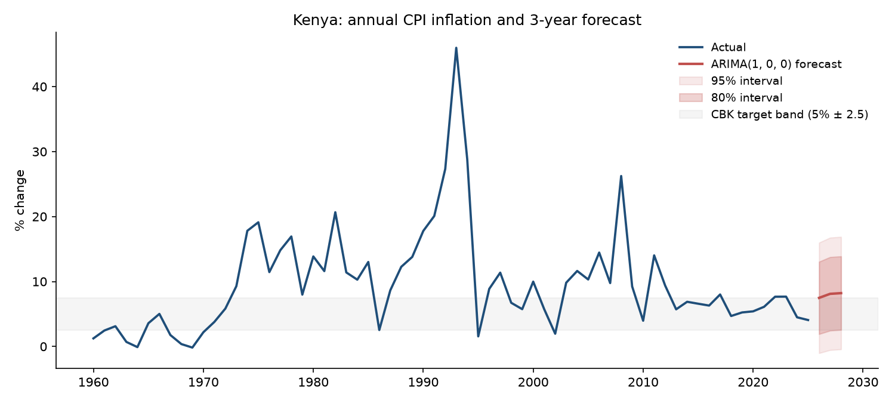
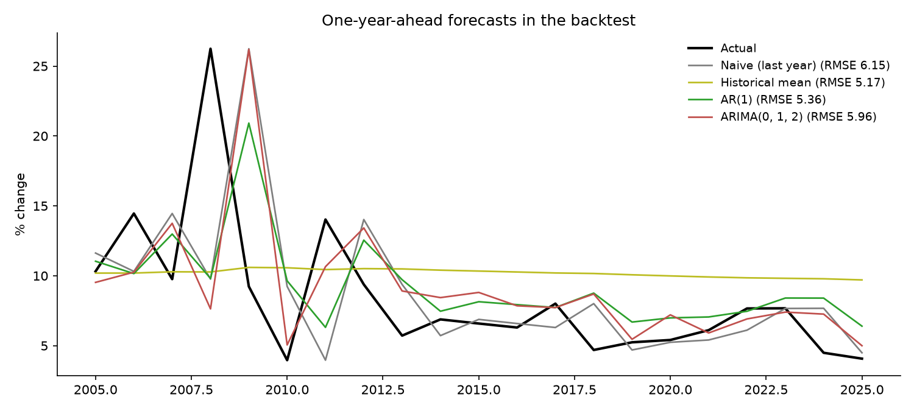

# Forecasting Kenya's Inflation

How well can simple time-series models forecast Kenya's annual CPI inflation, and what do they suggest for 2026–2028?



## Question

Forecasts of inflation feed into budgeting, wage setting and project appraisal. Before trusting a model, it should beat simple rules of thumb on data it has not seen. This project tests that with 66 years of data (1960–2025).

## Data

- **Series:** Inflation, consumer prices (annual %), `FP.CPI.TOTL.ZG`
- **Source:** [World Bank World Development Indicators](https://data.worldbank.org/indicator/FP.CPI.TOTL.ZG?locations=KE), downloaded through the WDI API and cached in [`data/kenya_inflation.csv`](data/kenya_inflation.csv)

## Method

1. **Stationarity check:** an augmented Dickey–Fuller test rejects a unit root (p = 0.002).
2. **Model selection:** ARIMA(p, d, q) chosen by AIC on pre-2005 data only, so the backtest stays out-of-sample.
3. **Rolling-origin backtest, 2005–2025:** each year is forecast one step ahead using only earlier data. Four approaches are compared:
   - naive (last year's value)
   - historical mean
   - AR(1)
   - the AIC-selected ARIMA
4. **Final forecast:** the better-performing time-series model is re-estimated on the post-1996 regime, which leaves out the early-1990s spike (46% in 1993). It then forecasts three years ahead with 80% and 95% intervals.

## Results

| Model | RMSE | MAE |
|---|---|---|
| Historical mean | 5.17 | 4.08 |
| AR(1) | 5.36 | 3.63 |
| ARIMA(0,1,2) | 5.96 | 3.47 |
| Naive (last year) | 6.15 | 3.84 |



- **Simple benchmarks are hard to beat.** The historical mean has the lowest RMSE. The ARIMA has the lowest MAE but is penalised by large misses in shock years (2008, 2011). This is a common and useful finding: annual inflation is dominated by food and fuel shocks that past values cannot predict.
- **AR(1) forecast:** about **7.5% in 2026**, drifting towards the long-run post-1996 average of about 8%. The 80% interval is roughly 2–13%, which shows how uncertain one-year-ahead inflation is.
- 2024–25 inflation (4.5% and 4.1%) sat inside the Central Bank of Kenya's 5% ± 2.5 target band. A pure time-series model doesn't capture the monetary-policy regime, so the forecast reverts towards history.

## Limitations and next steps

- Annual data gives few observations. Monthly KNBS CPI would allow seasonal models and much tighter backtests.
- No explanatory variables yet. Adding exchange rates, fuel prices, rainfall and the CBK rate (ARIMAX or VAR) is the natural extension.
- Regime changes, such as liberalisation in the 1990s and inflation targeting, are handled by sample choice rather than modelled explicitly.

## Reproduce

```bash
pip install -r requirements.txt
python src/analysis.py
```

Outputs are written to `results/` (backtest scores, forecasts) and `figures/`.

---
*Author: Denis Mburu, Economist and Statistician*
